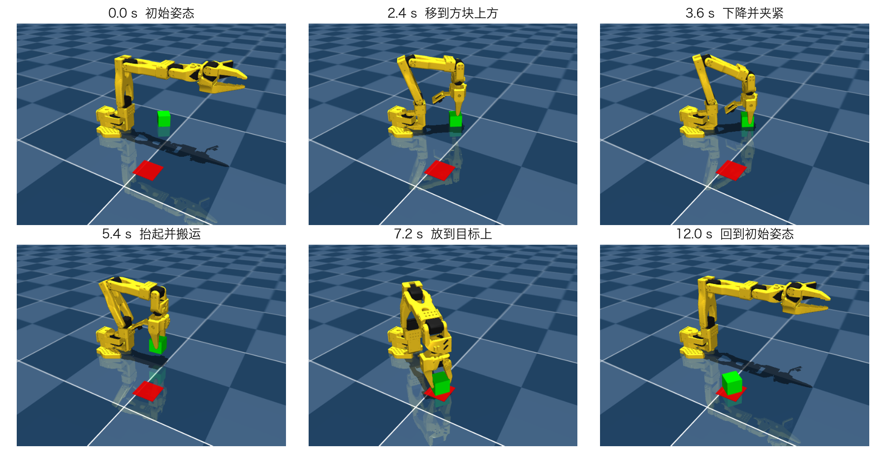
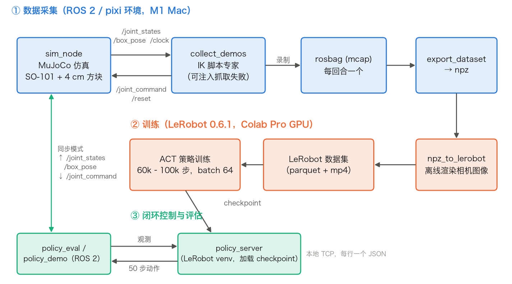
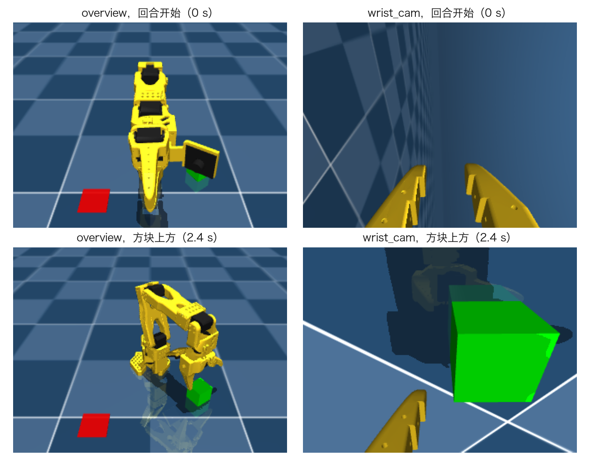
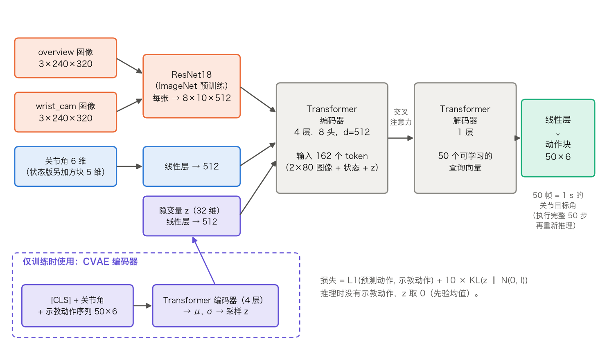
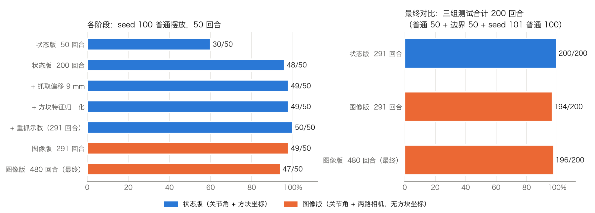
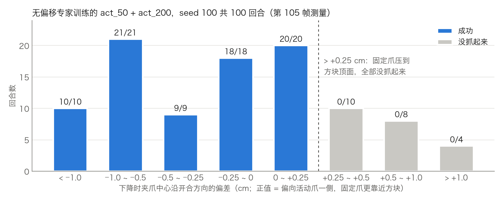

# 基于 ROS 2 与 MuJoCo 的 SO-101 机械臂模仿学习：抓取放置任务

Physical AI 课程期末作业报告（个人独立完成）

## 1. 概述

### 1.1 作业要求

作业要求：用 ROS 2 连接一个机器人仿真器，用仿真器生成训练数据，用这些数据训练一个模型，最后用训练好的模型控制机器人完成某个任务。

### 1.2 本作业做了什么

本作业选用 MuJoCo 仿真开源机械臂 SO-101（6 个关节，含夹爪），任务是**把桌面上的 4 cm 绿色立方体抓起来，放到红色目标框里**（pick-and-place）。

- 每个回合开始时，方块的位置和朝向都是随机的：到机械臂基座的距离 r ∈ [0.18, 0.25] m，方位角 5°–40°，绕竖直轴的朝向任意。目标框固定在基座右前方。
- 方块中心到目标中心的水平距离小于 3 cm，并且方块落在地面上，算作成功。

整体流程分四步：

1. 自己写了一个 ROS 2 节点，把 MuJoCo 仿真包装成话题和服务；
2. 用基于逆运动学（IK）的脚本专家自动完成任务，并用 rosbag 录下示教数据；
3. 把数据转换成 LeRobot 数据集，在 Colab 上训练 **ACT**（Action Chunking with Transformers）策略；
4. 让训练好的策略通过 ROS 2 闭环控制仿真中的机械臂，并统计成功率。

*图 1　最终的图像版策略完成一次抓取放置。绿色为方块，红色为目标框。*

### 1.3 最终效果

用训练时没见过的方块摆放（固定随机种子）做了三组测试，共 200 个回合：普通摆放 50 回合、抓法切换“边界”附近的困难摆放 50 回合（见 5.4 节），另一个种子的普通摆放 100 回合。

| 模型 | 观测 | 成功率（200 回合） | 成功回合的放置误差 |
|---|---|---|---|
| **图像版 ACT（最终模型）** | 关节角 + 两路相机图像，**不给方块坐标** | **196/200 = 98%** | 平均约 0.67 cm |
| 状态版 ACT（对照） | 关节角 + 方块坐标和朝向 | 200/200 = 100% | 平均约 0.5 cm |

- 只要方块被抓起来，放置几乎都很准（误差远小于 3 cm 的阈值）。剩下的失败集中在抓取阶段，以及搬运中途掉落。
- 推理耗时：状态版约 2 ms/步，图像版约 7–8 ms/步（含两张图像的 ResNet18 前向，CPU 上运行），满足 50 Hz 控制。
- 另外做了一个交互演示：在控制面板上用滑块摆放方块，点击开始后实时观看策略去抓（`scripts/demo.sh`）。

## 2. 系统架构

*图 2　系统架构：数据采集（蓝）、训练（橙）、闭环控制（绿）。*

**开发环境与选型。** 开发机是 Apple M1 Mac，没有 NVIDIA GPU，Isaac Sim / Isaac Lab 用不了。MuJoCo 原生支持 Mac、上手简单，和 LeRobot 生态也接得上，所以选了 MuJoCo。ROS 2 Jazzy 通过 RoboStack + pixi 安装。RoboStack 在 osx-arm64 上没有 `mujoco_ros2_control`，因此仿真接口是自己用 rclpy + mujoco 写的节点 `sim_node`，不经过 ros2_control。

**ROS 2 接口（`sim_node`）。**

| 方向 | 名称 | 内容 |
|---|---|---|
| 发布 | `/joint_states` | 6 个关节的角度，50 Hz |
| 发布 | `/box_pose` | 方块位姿（状态版策略和成功判定使用） |
| 发布 | `/clock` | 仿真时间 |
| 订阅 | `/joint_command` | 6 个关节的目标角 |
| 服务 | `/reset` | 重置回合，按随机种子重新摆放方块 |

**同步模式。** 采集和评估都运行在同步模式（`sync_mode`）下：仿真每发布一帧状态，就等控制端回应这一帧之后再往前走一步。控制端发布的指令时间戳与它所回应的状态时间戳相同，所以数据里的“状态—动作”是严格一一对应的。不用同步模式时，控制端一旦卡顿，就会录下“动作在变、状态冻结”的坏数据。

**训练与推理的环境隔离。** LeRobot（含 PyTorch）和 RoboStack 的 numpy 等依赖有版本冲突，所以没有装进 ROS 环境：训练在 Colab Pro 的 GPU 上进行；本机推理时，`policy_server.py` 在单独的 venv 里加载模型，ROS 节点 `policy_eval` / `policy_demo` 通过本地 TCP（每行一个 JSON）发送观测、取回动作。

## 3. 任务与数据

### 3.1 场景

MuJoCo Menagerie 自带的 SO-101 场景中，方块放在 x = 0.5 m 处，超出了末端最大伸展距离（约 0.48 m），够不到，所以新建了场景 `scene_pick_place.xml`。方块尺寸和摆放范围由离线测试确定：

- 夹爪朝下时末端最低只能到 z ≈ 0.06–0.09 m（受腕关节限位约束），所以用 4 cm 立方体，否则张开的夹爪越不过方块；
- r < 0.16 m 时，夹爪上的相机支架会撞到肩部；r > 0.26 m 时，朝下的姿态够不到悬停高度。最终范围定为 r ∈ [0.18, 0.25] m。

### 3.2 脚本专家

专家（`expert.py`）根据回合开始时的方块位姿，用数值 IK 规划整条轨迹：移到方块上方 → 转好手腕、竖直下降 → 夹紧 → 抬起 → 平移到目标上方 → 下降、松开 → 回到初始姿态并保持不动。一个回合约 10 s（500 帧左右）。

立方体每转 90° 外观相同，专家选择**最接近“与手臂垂直”方向的一对侧面**来夹。设方块朝向相对方位角的角度为 g（折算到 [−45°, 45°)），在 g = ±45° 处专家会换另一对侧面，手腕角会跳约 90°。这个不连续点后来成为主要的难点（5.4 节）。

在整个随机范围内，专家离线测试的成功率是 600/600。

### 3.3 数据格式

数据以 50 Hz 录制，每帧包含：

| | 内容 | 维度 |
|---|---|---|
| 输入（状态版） | 关节角 + 方块特征 `[x, y, z, cos 4ψ, sin 4ψ]` | 6 + 5 |
| 输入（图像版） | 关节角 + `overview`（固定俯视相机）+ `wrist_cam`（腕部相机）图像 | 6 + 2 × 3×240×320 |
| 输出 | 6 个关节（含夹爪）的目标角 | 6 |

方块朝向用 4ψ 的正余弦编码，因为立方体每转 90° 看起来一样，这样编码在 ψ 和 ψ + 90° 处取值相同，也是连续的。

图像版的数据由录下的关节角和方块位姿离线渲染得到；评估时 `sim_node` 用同一个渲染器实时渲染，两者逐像素一致。

*图 3　图像版策略的输入（240×320）。`overview` 看全局；`wrist_cam` 装在手腕上，接近方块时能看清方块的边，用来判断朝向。*

数据处理流程：每回合一个 rosbag（mcap）→ `export_dataset` 按时间戳对齐、导出 npz → `npz_to_lerobot.py` 转成 LeRobot 数据集（图像存为 mp4）。

### 3.4 数据集版本

| 数据集 | 回合数 | 说明 |
|---|---|---|
| 初版 | 50 / 200 | 专家无抓取偏移 |
| 偏移版 | 200（101,200 帧） | 抓取点朝固定爪偏移 9 mm（5.2 节） |
| + 重抓示教 | 291 | 再加 91 回合“第一次抓空 → 重新抓取”的示教（5.4 节） |
| 最终版 | 480（274,790 帧） | 末尾保持 2 s 的重采数据 200 + 重抓 94 + 边界附近 100 + 边界重抓 86（5.4、5.5 节） |

每一批数据用不同的随机种子采集，测试用的种子（100、101）从未用于训练。

## 4. 模型与训练

### 4.1 ACT 策略

各阶段都使用 LeRobot 0.6.1 中的 ACT 策略，只改变输入和训练数据。

*图 4　ACT 的结构（以最终的图像版为例）。*

- **输入编码**：两张图像各经过 ImageNet 预训练的 ResNet18，得到 8×10 的特征图，每个位置是一个 token（共 160 个）；关节角经线性层得到 1 个 token；状态版没有图像，改为方块特征再经线性层得到 1 个 token。
- **Transformer**：4 层编码器（8 头，d = 512），1 层解码器。解码器用 50 个可学习的查询向量，通过交叉注意力读取编码器输出。
- **输出：动作块（action chunk）**。一次预测未来 50 帧（1 s）的关节目标角，执行完这 50 步后再重新推理。一次输出一段轨迹，比逐帧预测更平滑，也能减少误差的逐帧累积。
- **CVAE**：训练时，另一个 Transformer 编码器读入示教的动作序列，压缩成 32 维隐变量 z，用来表达“同一观测下示教可能有多种做法”；推理时 z 取 0。损失 = L1（预测动作与示教动作）+ 10 × KL。

### 4.2 训练设置

| 项目 | 设置 |
|---|---|
| 平台 | Colab Pro GPU（本机 M1 的 MPS 约 5 step/s，太慢，只用于冒烟测试） |
| batch / 学习率 | 64 / 1e-5（含 backbone） |
| 步数 | 状态版 40k–60k，图像版 60k–100k |
| 归一化 | 状态、方块特征、图像、动作均用 MEAN_STD |
| 执行方式 | `chunk_size = n_action_steps = 50`，不使用时间集成 |

训练曲线记录在 Weights & Biases；checkpoint 用闭环成功率来挑选，不只看训练损失。

### 4.3 各阶段一览

| 阶段 | 输入 | 训练数据 | 步数 | 测试结果（seed 100 普通 50 回合） |
|---|---|---|---|---|
| ① 基线 | 关节角 + 方块特征 | 初版 50 回合 | 60k | 30/50 = 60% |
| ② 增加数据 | 同上 | 初版 200 回合 | 60k | 48/50 = 96% |
| ③ 抓取偏移 | 同上 | 偏移版 200 回合 | 40k | 49/50 = 98% |
| ④ 方块特征归一化 | 同上 | 同上 | 40k | 49/50，放置误差 0.88 → 0.58 cm |
| ⑤ 重抓示教 | 同上 | 291 回合 | 60k | **50/50**（三组测试合计 200/200） |
| ⑥ 改用图像 | 关节角 + 两路图像 | 291 回合（同一批示教） | 60k | 49/50（合计 194/200） |
| ⑦ 最终模型 | 同上 | 480 回合 | 100k | 47/50（合计 **196/200**） |

*图 5　左：每个阶段在同一组 50 个测试回合上的成功率。右：最后三个模型在全部三组测试（200 回合）上的成功率。只看左图，⑦ 比 ⑥ 少 2 个；但 ⑦ 在边界测试上从 47/50 提高到 50/50，合计略好。*

从 ⑤ 到 ⑥ 是一个有意的取舍：状态版直接拿到了方块的精确坐标，这在真实场景中通常得不到。图像版只看相机画面，更接近实际应用，代价是要自己从图像中估计方块的位置和朝向。

## 5. 遇到的问题与改进

每一次改进都来自对失败回合的分析：把失败回合的关节角和方块位姿放回 MuJoCo 中逐帧检查接触，再离线统计抓取精度（`scripts/grasp_metrics.py`）。测试时各模型的方块摆放逐回合相同，所以可以配对比较。

### 5.1 数据量不足

只用 50 回合时成功率是 60%，200 回合时提高到 96%。逐回合配对，18 个结果不一致的回合全部是 200 回合模型成功、50 回合模型失败（McNemar 检验 p ≈ 7.6×10⁻⁶）。两个模型的差别只在抓取这一步，一旦抓起来，放置误差都在 0.7 cm 左右。所以之后的数据都至少是 200 回合。

### 5.2 固定爪压在方块顶上

200 回合模型剩下的失败都是“没抓起来”：夹爪下降时被挡住，停在方块顶面高度。查接触发现，压在方块顶面边缘的是**固定爪**。SO-101 的夹爪一边固定、一边活动，专家把夹爪中心对准方块中心时，张开的固定爪离方块侧面只有约 0.6 mm，没有给策略的模仿误差留余量。图 6 显示，夹爪中心只要朝活动爪一侧偏出 2.5 mm 以上，就全部失败。改进办法是让专家抓取时把夹爪朝固定爪一侧平移 9 mm（闭合时方块会被推向固定爪，所以夹住后方块又回到中心，放置不受影响）。改后原来失败的回合都成功了。加偏移后，离线验证发现 r ≈ 0.17 m 处有一部分朝向会让相机支架撞到肩部，所以 r 的下限从 0.17 m 提到 0.18 m。

*图 6　加偏移之前，下降时夹爪中心沿开合方向的偏差与抓取成败。一个量就能完全区分成败。*

### 5.3 方块特征没有归一化

检查 checkpoint 时发现，LeRobot ACT 默认的归一化设置里没有 `ENV` 这一类特征，方块特征（`observation.environment_state`）其实是按原值输入的。方块坐标以米为单位，回合之间只差几厘米，而其他输入都归一化到了均值 0、方差 1 附近，不归一化时网络很难分辨方块位置的细小差别。训练时显式加上 `ENV: MEAN_STD` 后，成功率不变（49/50），放置误差从 0.88 cm 降到 0.58 cm。

### 5.4 抓法切换的边界（g ≈ ±45°）

加偏移之后，剩下的失败都集中在相对抓取角 g ≈ ±45° 附近：专家在这里换另一对侧面抓，手腕角相差约 90°，而策略在两种示教之间取了平均，手腕少转约 30°，固定爪又压到方块上。另外，之前的策略一旦抓空，只会空手完成搬运，再回到初始姿态把整个任务从头做一遍，不会就地重抓。改进分两步：

1. **重抓示教**：专家改为分段执行，抬起后检查方块是否离地，没有就回到方块上方重新抓。采集时以一定概率故意让第一次抓取失败（手腕偏转或位置偏移），只导出重抓开始之后的片段，让策略学到“抓空后怎么补救”。加入 91 回合重抓示教后（⑤），状态版在三组测试上 200/200。
2. **边界补充数据**（针对图像版）：图像版只能从图像估计方块朝向，误差有几度，在边界附近更容易选错抓法，风险区从 |g| ≈ 45° 扩大到 |g| ≳ 35°（⑥ 的 6 次失败全在这里）。为此专门在 |g| ∈ [30°, 45°] 内补采了 100 回合正常示教，以及 86 回合“手腕停在两种抓法中间（模仿策略的典型错误）→ 重抓”的示教。⑦ 在边界测试上从 47/50 提高到 50/50，固定爪先碰到方块的回合从 21/50 降到 2/50。

### 5.5 成功之后又去抓一次

图像版 ⑥ 在把方块放好、回到初始姿态之后，几乎每个回合（192/194）都会再把手臂伸出去，好像要再抓一次（不影响成功判定，但演示时很不自然）。原因是示教末尾只录了 0.5 s 的保持，比 1 s 的动作块还短，训练数据中几乎没有“方块已在目标上、手臂停在初始姿态”的画面，模型看到方块就推断“该去抓了”。状态版没有这个问题（0/150），是因为方块坐标明确告诉它方块已经在目标上了。把采集时末尾的保持时间改为 2 s 并重新采集后（⑦），这个现象完全消失（0/196）。

## 6. 最终评估

### 6.1 评估方法

- 评估节点 `policy_eval` 在同步模式下运行，每回合最多 900 帧（18 s），记录成功与否、成功的帧号、放置误差、是否抓起、抓取次数。
- 三组测试都用训练中没用过的随机种子：seed 100 普通摆放 50 回合；seed 100 边界摆放 50 回合（限定 |g| ∈ [35°, 45°]）；seed 101 普通摆放 100 回合。
- 同一组测试中各模型的方块摆放逐回合相同，可以做配对检验。

### 6.2 结果

| 测试 | 状态版 ⑤ | 图像版 ⑥ | **图像版 ⑦（最终）** |
|---|---|---|---|
| seed 100 普通（50） | 50 | 49 | 47 |
| seed 100 边界（50） | 50 | 47 | **50** |
| seed 101 普通（100） | 100 | 98 | 99 |
| **合计（200）** | **200** | 194 | **196** |
| 放置误差（成功回合平均） | 约 0.5 cm | 约 0.57 cm | 约 0.67 cm |
| 成功后又乱动 | 0 | 192/194 | **0/196** |
| 推理耗时 | 约 2 ms/步 | 约 7–8 ms/步 | 约 7–8 ms/步 |

- 最终模型 ⑦ 与 ⑥ 的成功率差别（196 对 194）在统计上不显著（配对 McNemar p = 0.73），但边界区域的失败方式明显改善，成功后保持不动的问题也解决了。
- 图像版仍略逊于状态版。差距主要来自抓取朝向的估计：状态版直接拿到精确朝向，图像版要从 240×320 的图像中估计。

### 6.3 剩余的失败

最终模型的 4 次失败：

| 类型 | 次数 | 说明 |
|---|---|---|
| 搬运途中掉落 | 2 | 只夹住方块边缘，搬运时夹爪又慢慢松开，方块中途滑出 |
| 手腕停在两种抓法中间 | 1 | g ≈ 36°，手腕角正好在两种抓法的中点，反复抓都没抬起 |
| 手腕转过头 | 1 | g ≈ 26°，朝向偏了约 15°，固定爪先碰到方块 |

这些失败的原因与“朝向估计不准”和“补充数据带来的副作用”有关，样本还太少，未能完全确认。

## 7. 总结与展望

### 7.1 总结

本作业搭建了“MuJoCo 仿真 → ROS 2 接口 → 脚本专家采集示教 → LeRobot 训练 ACT → ROS 2 闭环控制”的完整流程，最终的图像版 ACT 在不知道方块坐标的情况下，200 个测试回合中成功 196 个。

开发中的体会是，**分析失败比单纯加数据更有效**。从 96% 往上的每一步改进（抓取偏移、特征归一化、重抓示教、边界数据、保持时间），都是先逐回合找出失败的机制，再针对性地修改专家或数据。模仿学习的上限很大程度上取决于示教本身：专家的抓取余量、示教的覆盖范围、甚至回合末尾保持多久，都会直接体现在策略的行为里。

### 7.2 局限

- 目标框位置是固定的，观测里没有目标信息，策略实际上是记住了目标的位置。
- 只在仿真中验证，没有处理渲染与真实图像的差异、真实物理参数等问题。
- 图像版对方块朝向的判断仍不够精确，换抓法的边界附近仍有风险。

### 7.3 后续方向

- **随机目标**：已验证可以在初始姿态时从 `overview` 图像中定位红色目标框（离线原型平均误差 1.5 mm），下一步是让目标位置也随机，并把目标信息加入观测。
- **改进朝向估计**：提高腕部相机分辨率，或在推理时使用 ACT 的时间集成，让手腕角在接近方块的过程中逐步修正。
- **更大的模型**：尝试 SmolVLA 等视觉-语言-动作模型。
- **迁移到真机**：SO-101 是开源的低成本机械臂，可以尝试把仿真中学到的策略迁移到真实机械臂上。

## 附录：复现

环境搭建和各命令的详细用法见代码中的 `README_CN.md`。

| 步骤 | 命令 / 文件 |
|---|---|
| 环境 | `pixi install`，`pixi run build` |
| 采集示教 | `collect_demos`（命令见 `README_CN.md`） |
| 导出数据集 | `export_dataset` → `scripts/npz_to_lerobot.py` |
| 训练 | `notebooks/train_act_colab.ipynb`（状态版）、`notebooks/train_act_images_colab.ipynb`（图像版） |
| 评估 | `scripts/run_evals.sh` |
| 交互演示 | `pixi run bash scripts/demo.sh` |
| 报告配图 | `pixi run python scripts/make_report_figures.py` |

各阶段的详细评估记录见 `docs/eval_*.md`。
