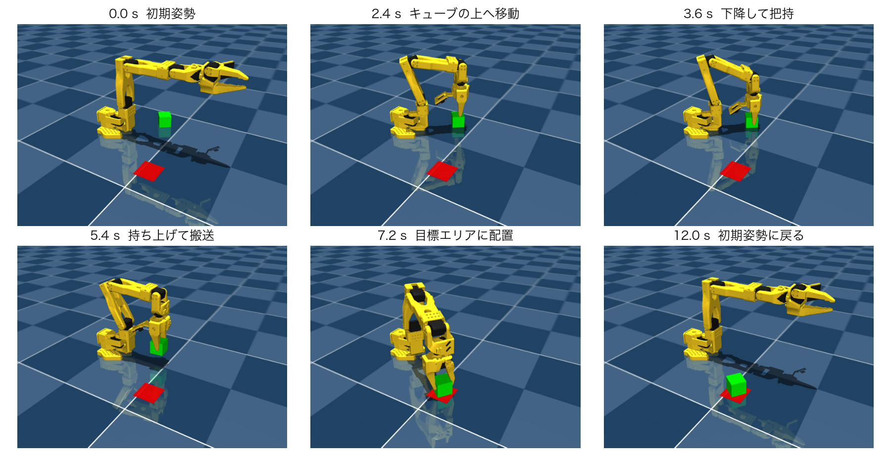
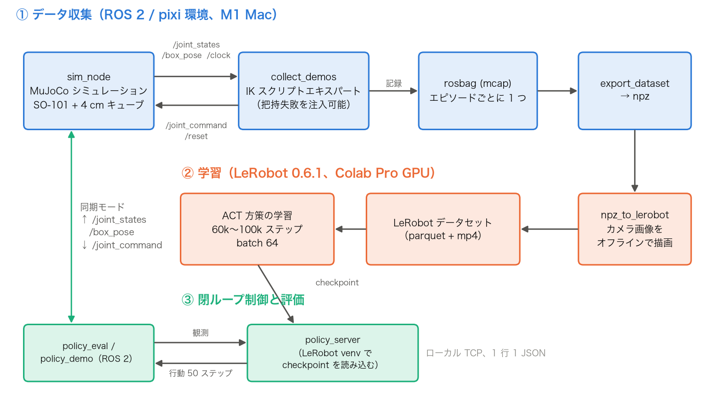
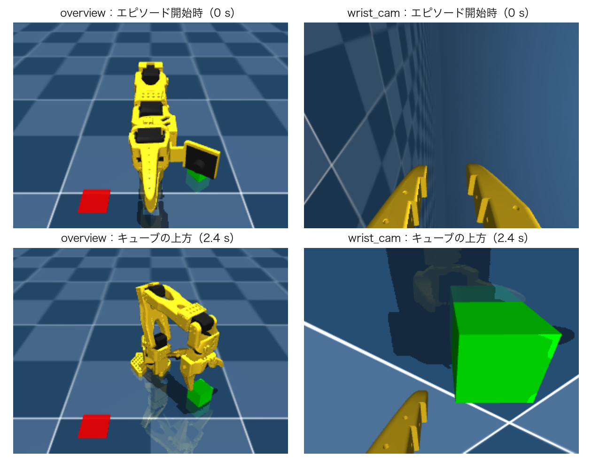
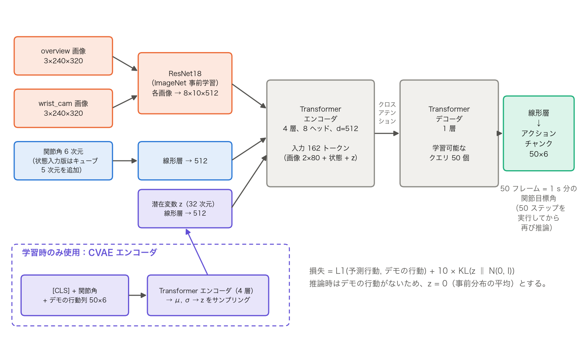
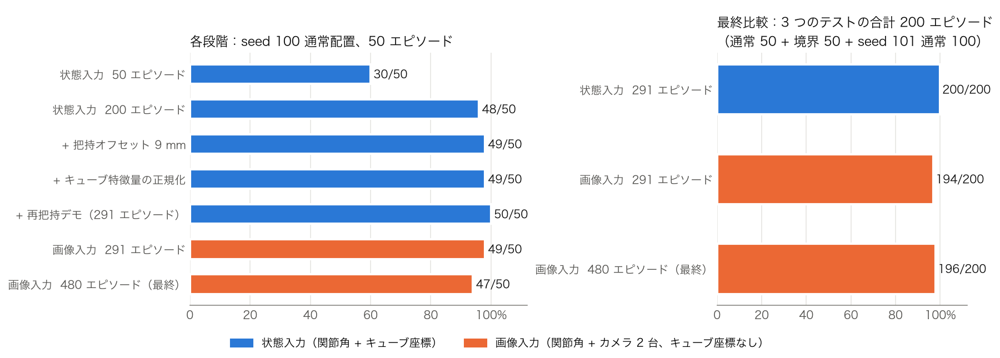
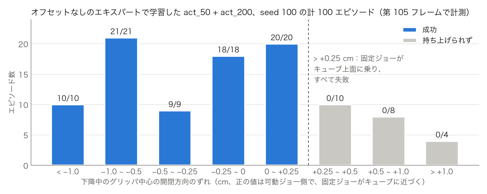

# ROS 2 と MuJoCo による SO-101 ロボットアームの模倣学習：ピック・アンド・プレース課題

Physical AI 講義 期末課題レポート（個人課題）

ソースコード：<https://github.com/drogen120/adv1_final_project>

## 1. 概要

### 1.1 課題の内容

本課題の要件は、ROS 2 でロボットシミュレータと接続し、シミュレータで学習データを生成し、そのデータでモデルを学習させ、最後に学習済みモデルでロボットを制御して何らかのタスクを達成することである。

### 1.2 本課題で行ったこと

MuJoCo 上でオープンソースのロボットアーム SO-101（グリッパを含む 6 関節）をシミュレーションし、**机上の一辺 4 cm の緑色のキューブを持ち上げ、赤色の目標エリアに置く**タスク（ピック・アンド・プレース）に取り組んだ。

- 各エピソードの開始時に、キューブの位置と向きをランダムに決める。アームの基部からの距離は r ∈ [0.18, 0.25] m、方位角は 5°～40°、鉛直軸まわりの向きは任意である。目標エリアは基部の右前方に固定されている。
- キューブ中心と目標中心の水平距離が 3 cm 未満で、かつキューブが床面に置かれていれば成功とする。

全体の流れは次の 4 段階である。

1. MuJoCo シミュレーションをトピックとサービスとして公開する ROS 2 ノードを自作した。
2. 逆運動学（IK）に基づくスクリプト化されたエキスパートにタスクを自動で実行させ、そのデモを rosbag に記録した。
3. 記録したデータを LeRobot のデータセットに変換し、Colab 上で **ACT**（Action Chunking with Transformers）方策を学習させた。
4. 学習済みの方策から ROS 2 経由でシミュレーション内のアームを閉ループ制御し、成功率を評価した。

*図 1　最終的な画像入力モデルによるピック・アンド・プレースの様子。緑がキューブ、赤が目標エリアである。*

### 1.3 最終的な結果

学習に使っていないキューブ配置（乱数シードを固定）で 3 種類のテストを行った。合計 200 エピソードで、内訳は通常配置 50 エピソード、掴み方が切り替わる「境界」付近の難しい配置 50 エピソード（5.4 節）、別のシードによる通常配置 100 エピソードである。

| モデル | 観測 | 成功率（200 エピソード） | 成功時の配置誤差 |
|---|---|---|---|
| **画像入力 ACT（最終モデル）** | 関節角 + カメラ 2 台の画像、**キューブ座標は与えない** | **196/200 = 98%** | 平均約 0.67 cm |
| 状態入力 ACT（比較用） | 関節角 + キューブの座標と向き | 200/200 = 100% | 平均約 0.5 cm |

- キューブを持ち上げられれば、配置はほぼ正確である（誤差は閾値 3 cm より十分小さい）。残る失敗は把持の段階と、搬送中の落下に集中している。
- 推論時間は状態入力モデルで約 2 ms/ステップ、画像入力モデルで約 7～8 ms/ステップ（2 枚の画像に対する ResNet18 の順伝播を含む、CPU 上で実行）であり、50 Hz の制御に間に合う。
- このほか、操作パネルのスライダーでキューブを配置し、開始ボタンを押すと方策がリアルタイムにキューブを掴みに行く対話型デモも作成した（`scripts/demo.sh`）。

## 2. システム構成

*図 2　システム構成：データ収集（青）、学習（橙）、閉ループ制御（緑）。*

**開発環境と選定理由。** 開発機は Apple M1 Mac で NVIDIA GPU を持たないため、Isaac Sim / Isaac Lab は使えない。MuJoCo は Mac をネイティブにサポートし、扱いやすく、LeRobot のエコシステムとも接続しやすいため採用した。ROS 2 Jazzy は RoboStack と pixi でインストールした。RoboStack の osx-arm64 版には `mujoco_ros2_control` がないため、シミュレーションのインタフェースは rclpy と mujoco で書いた自作ノード `sim_node` とし、ros2_control は使っていない。

**ROS 2 インタフェース（`sim_node`）。**

| 方向 | 名前 | 内容 |
|---|---|---|
| 配信 | `/joint_states` | 6 関節の角度、50 Hz |
| 配信 | `/box_pose` | キューブの位置姿勢（状態入力モデルと成功判定で使用） |
| 配信 | `/clock` | シミュレーション時刻 |
| 購読 | `/joint_command` | 6 関節の目標角 |
| サービス | `/reset` | エピソードをリセットし、乱数シードに従ってキューブを置き直す |

**同期モード。** データ収集と評価はいずれも同期モード（`sync_mode`）で実行する。シミュレータは状態を 1 フレーム配信するたびに、制御側がそのフレームに応答するのを待ってから次のステップに進む。制御側が配信する指令のタイムスタンプは、応答対象の状態のタイムスタンプと同じにしてあるため、データ中の「状態と行動」は厳密に 1 対 1 で対応する。同期モードを使わないと、制御側が一時的に止まったときに「行動は変化しているのに状態が止まっている」不正なデータが記録されてしまう。

**学習環境と推論環境の分離。** LeRobot（PyTorch を含む）は RoboStack の numpy などと依存バージョンが衝突するため、ROS 環境には入れていない。学習は Colab Pro の GPU で行う。ローカルでの推論では、`policy_server.py` が別の venv でモデルを読み込み、ROS ノード `policy_eval` / `policy_demo` はローカル TCP（1 行に 1 つの JSON）で観測を送って行動を受け取る。

## 3. タスクとデータ

### 3.1 シーン

MuJoCo Menagerie に付属する SO-101 のシーンでは、キューブが x = 0.5 m に置かれており、エンドエフェクタの最大到達距離（約 0.48 m）を超えていて届かない。そこで新たにシーン `scene_pick_place.xml` を作成した。キューブの大きさと配置範囲はオフライン検証で決めた。

- グリッパを下向きにした姿勢では、手首関節の可動限界のためエンドエフェクタは z ≈ 0.06～0.09 m までしか下がらない。そのため 4 cm のキューブを使った（これより高いと、開いたグリッパがキューブを越えられない）。
- r < 0.16 m ではグリッパのカメラ支持部が肩に干渉し、r > 0.26 m では下向きの姿勢のまま待機高さに届かない。最終的に範囲を r ∈ [0.18, 0.25] m とした。

### 3.2 スクリプト化されたエキスパート

エキスパート（`expert.py`）は、エピソード開始時のキューブの位置姿勢から、数値 IK で軌道全体を計画する。キューブの上方へ移動 → 手首を回して鉛直に下降 → 把持 → 持ち上げ → 目標エリアの上方へ水平移動 → 下降して解放 → 初期姿勢に戻って静止、という流れである。1 エピソードは約 10 s（500 フレーム前後）である。

キューブは 90° 回転すると見た目が同じになるため、エキスパートは**アームに垂直な方向に最も近い 1 組の側面**を挟む。方位角に対するキューブの相対的な向きを g（[−45°, 45°) に折り返した値）とすると、g = ±45° でエキスパートはもう 1 組の側面に掴み替え、手首の角度が約 90° 跳ぶ。この不連続点が、後に主要な難所となった（5.4 節）。

配置範囲全体でのエキスパートのオフライン成功率は 600/600 である。

### 3.3 データ形式

データは 50 Hz で記録し、各フレームは以下を含む。

| | 内容 | 次元 |
|---|---|---|
| 入力（状態入力モデル） | 関節角 + キューブ特徴量 `[x, y, z, cos 4ψ, sin 4ψ]` | 6 + 5 |
| 入力（画像入力モデル） | 関節角 + `overview`（固定の俯瞰カメラ）と `wrist_cam`（手首カメラ）の画像 | 6 + 2 × 3×240×320 |
| 出力 | 6 関節（グリッパを含む）の目標角 | 6 |

キューブの向きを 4ψ の正弦・余弦で表すのは、キューブが 90° ごとに同じ見た目になるためである。この表し方なら ψ と ψ + 90° で同じ値になり、しかも連続である。

画像入力モデル用のデータは、記録した関節角とキューブの位置姿勢からオフラインで描画した。評価時は `sim_node` が同じレンダラでリアルタイムに描画するため、両者はピクセル単位で一致する。

*図 3　画像入力モデルの入力（240×320）。`overview` は全体を見渡す。`wrist_cam` は手首に取り付けられており、キューブに近づくとその辺がはっきり見えるため、向きの判断に使われる。*

データ処理の流れは、エピソードごとの rosbag（mcap）→ `export_dataset` でタイムスタンプを揃えて npz に書き出し → `npz_to_lerobot.py` で LeRobot データセットに変換（画像は mp4 として保存）である。

### 3.4 データセットの版

| データセット | エピソード数 | 説明 |
|---|---|---|
| 初版 | 50 / 200 | エキスパートに把持オフセットなし |
| オフセット版 | 200（101,200 フレーム） | 把持位置を固定ジョー側へ 9 mm ずらす（5.2 節） |
| + 再把持デモ | 291 | 「1 回目の把持に失敗 → 掴み直す」デモを 91 エピソード追加（5.4 節） |
| 最終版 | 480（274,790 フレーム） | 末尾 2 s の静止を含めて取り直した 200 + 再把持 94 + 境界付近 100 + 境界での再把持 86（5.4、5.5 節） |

データは版ごとに異なる乱数シードで収集し、テスト用のシード（100、101）は学習に一度も使っていない。

## 4. モデルと学習

### 4.1 ACT 方策

どの段階でも LeRobot 0.6.1 の ACT 方策を使い、入力と学習データだけを変えた。

*図 4　ACT の構造（最終的な画像入力モデルの場合）。*

- **入力の符号化**：2 枚の画像をそれぞれ ImageNet で事前学習した ResNet18 に通して 8×10 の特徴マップを得て、各位置を 1 トークンとする（計 160 トークン）。関節角は線形層で 1 トークンにする。状態入力モデルは画像を使わず、代わりにキューブ特徴量を線形層に通して 1 トークンにする。
- **Transformer**：4 層のエンコーダ（8 ヘッド、d = 512）と 1 層のデコーダからなる。デコーダは学習可能な 50 個のクエリを使い、クロスアテンションでエンコーダの出力を参照する。
- **出力：アクションチャンク**。将来 50 フレーム（1 s）分の関節目標角を一度に予測し、その 50 ステップを実行してから再び推論する。軌道をまとめて出力するので、フレームごとに予測するより動きが滑らかになり、誤差がフレームごとに積み重なるのも抑えられる。
- **CVAE**：学習時には、別の Transformer エンコーダがデモの行動列を読み込んで 32 次元の潜在変数 z に圧縮し、「同じ観測に対してもデモには複数のやり方があり得る」ことを表現する。推論時は z = 0 とする。損失は L1（予測行動とデモの行動）+ 10 × KL である。

### 4.2 学習設定

| 項目 | 設定 |
|---|---|
| 計算環境 | Colab Pro の GPU（ローカルの M1 の MPS では約 5 step/s と遅すぎるため、動作確認のみに使用） |
| バッチサイズ / 学習率 | 64 / 1e-5（バックボーンも同じ） |
| ステップ数 | 状態入力モデル 40k～60k、画像入力モデル 60k～100k |
| 正規化 | 状態、キューブ特徴量、画像、行動のすべてに MEAN_STD を適用 |
| 実行方式 | `chunk_size = n_action_steps = 50`、時間的アンサンブルは使わない |

学習曲線は Weights & Biases に記録した。チェックポイントは学習損失だけでなく、閉ループでの成功率で選んだ。

### 4.3 各段階の一覧

| 段階 | 入力 | 学習データ | ステップ数 | テスト結果（seed 100 通常配置 50 エピソード） |
|---|---|---|---|---|
| ① ベースライン | 関節角 + キューブ特徴量 | 初版 50 エピソード | 60k | 30/50 = 60% |
| ② データ増量 | 同上 | 初版 200 エピソード | 60k | 48/50 = 96% |
| ③ 把持オフセット | 同上 | オフセット版 200 エピソード | 40k | 49/50 = 98% |
| ④ キューブ特徴量の正規化 | 同上 | 同上 | 40k | 49/50、配置誤差 0.88 → 0.58 cm |
| ⑤ 再把持デモ | 同上 | 291 エピソード | 60k | **50/50**（3 つのテストの合計 200/200） |
| ⑥ 画像入力へ移行 | 関節角 + カメラ 2 台の画像 | 291 エピソード（同じデモ） | 60k | 49/50（合計 194/200） |
| ⑦ 最終モデル | 同上 | 480 エピソード | 100k | 47/50（合計 **196/200**） |

*図 5　左：各段階の、同じ 50 テストエピソードでの成功率。右：最後の 3 モデルの、3 つのテスト全体（200 エピソード）での成功率。左図だけを見ると ⑦ は ⑥ より 2 エピソード少ないが、⑦ は境界テストで 47/50 から 50/50 に改善しており、合計ではわずかに上回る。*

⑤ から ⑥ への移行は意図的なトレードオフである。状態入力モデルはキューブの正確な座標を直接受け取っているが、現実の環境では通常この情報は得られない。画像入力モデルはカメラ画像だけを見るので実用に近いが、その代わりにキューブの位置と向きを画像から自ら推定しなければならない。

## 5. 直面した問題と改善

いずれの改善も、失敗エピソードの分析から得たものである。失敗エピソードの関節角とキューブの位置姿勢を MuJoCo に戻してフレームごとに接触を調べ、さらに把持精度をオフラインで集計した（`scripts/grasp_metrics.py`）。テストでは各モデルのキューブ配置がエピソードごとに同一なので、対応のある比較ができる。

### 5.1 データ量の不足

50 エピソードだけで学習すると成功率は 60% だったが、200 エピソードでは 96% に上がった。エピソードごとに対応をとると、結果が食い違った 18 エピソードはすべて「200 エピソードのモデルが成功し、50 エピソードのモデルが失敗」したものだった（McNemar 検定 p ≈ 7.6×10⁻⁶）。両モデルの差は把持の段階だけにあり、持ち上げた後の配置誤差はどちらも 0.7 cm 程度だった。そこで以降のデータはすべて 200 エピソード以上とした。

### 5.2 固定ジョーがキューブの上面に乗る

200 エピソードのモデルに残った失敗は、すべて「持ち上げられない」ものだった。グリッパが下降中に引っかかり、キューブ上面の高さで止まってしまう。接触を調べると、キューブ上面の縁に乗っていたのは**固定ジョー**だった。SO-101 のグリッパは片側が固定、もう片側が可動である。エキスパートがグリッパ中心をキューブ中心に合わせると、開いた固定ジョーとキューブ側面の隙間はわずか約 0.6 mm しかなく、方策の模倣誤差を許容する余裕がなかった。図 6 のとおり、グリッパ中心が可動ジョー側へ 2.5 mm 以上ずれると、すべて失敗している。そこで、エキスパートが把持するときにグリッパを固定ジョー側へ 9 mm ずらすように改めた（閉じるとキューブが固定ジョー側へ押されるので、把持後はキューブが再び中心に来て、配置には影響しない）。この変更で、以前失敗していたエピソードはすべて成功した。なお、オフセットを加えた後のオフライン検証で、r ≈ 0.17 m では一部の向きでカメラ支持部が肩に干渉することがわかったため、r の下限を 0.17 m から 0.18 m に引き上げた。

*図 6　オフセット導入前の、下降中のグリッパ中心の開閉方向のずれと把持の成否。この 1 つの量だけで成否が完全に分かれる。*

### 5.3 キューブ特徴量が正規化されていなかった

チェックポイントを調べたところ、LeRobot の ACT の既定の正規化設定には `ENV` という種類の特徴量が含まれておらず、キューブ特徴量（`observation.environment_state`）は生の値のまま入力されていた。キューブ座標はメートル単位で、エピソード間の差は数 cm しかない。一方、他の入力はすべて平均 0、分散 1 付近に正規化されているため、正規化しないとネットワークはキューブ位置のわずかな違いを区別しにくい。学習時に `ENV: MEAN_STD` を明示的に指定したところ、成功率は変わらなかった（49/50）が、配置誤差は 0.88 cm から 0.58 cm に下がった。

### 5.4 掴み方が切り替わる境界（g ≈ ±45°）

オフセット導入後に残った失敗は、すべて相対把持角 g ≈ ±45° の付近に集中していた。エキスパートはここで掴む側面を切り替えるため手首の角度が約 90° 異なり、方策は 2 種類のデモを平均してしまう。その結果、手首の回転が約 30° 足りず、固定ジョーが再びキューブに乗ってしまう。また、それまでの方策は一度掴み損ねると、何も持たないまま搬送を終え、初期姿勢に戻ってからタスク全体を最初からやり直すだけで、その場で掴み直すことができなかった。改善は 2 段階で行った。

1. **再把持デモ**：エキスパートを段階ごとに実行する方式に変え、持ち上げた後にキューブが床から離れたかを確認し、離れていなければキューブの上方に戻って掴み直すようにした。収集時には一定の確率で 1 回目の把持をわざと失敗させ（手首の回転のずれ、または位置のずれ）、掴み直しが始まった後の区間だけを書き出すことで、方策に「掴み損ねたときの立て直し方」を学ばせた。再把持デモを 91 エピソード加えたところ（⑤）、状態入力モデルは 3 つのテストで 200/200 となった。
2. **境界付近の追加データ**（画像入力モデル向け）：画像入力モデルはキューブの向きを画像から推定するしかなく、数度の誤差がある。そのため境界付近で掴み方を選び間違えやすく、危険な範囲が |g| ≈ 45° から |g| ≳ 35° まで広がった（⑥ の 6 回の失敗はすべてこの範囲）。そこで |g| ∈ [30°, 45°] に限定して、通常のデモ 100 エピソードと、「手首が 2 種類の掴み方の中間で止まる（方策の典型的な誤りを模したもの）→ 掴み直す」デモ 86 エピソードを追加で収集した。⑦ は境界テストで 47/50 から 50/50 に改善し、固定ジョーが先にキューブに触れたエピソードは 21/50 から 2/50 に減った。

### 5.5 成功した後にもう一度掴みに行く

画像入力モデル ⑥ は、キューブを置いて初期姿勢に戻った後、ほぼすべてのエピソード（192/194）で再びアームを伸ばし、もう一度掴みに行くような動きを見せた（成功判定には影響しないが、デモとしては不自然である）。原因は、デモの末尾の静止区間が 0.5 s しか記録されておらず、1 s のアクションチャンクより短かったことにある。学習データに「キューブがすでに目標エリアにあり、アームが初期姿勢で静止している」画像がほとんどないため、モデルはキューブが見えると「掴みに行くべきだ」と推測してしまう。状態入力モデルにこの問題がない（0/150）のは、キューブがすでに目標エリアにあることをキューブ座標が明示しているからである。収集時の末尾の静止時間を 2 s に変更してデータを取り直したところ（⑦）、この現象は完全に消えた（0/196）。

## 6. 最終評価

### 6.1 評価方法

- 評価ノード `policy_eval` を同期モードで実行し、1 エピソードあたり最大 900 フレーム（18 s）とした。成功の有無、成功したフレーム番号、配置誤差、持ち上げたか、把持の試行回数を記録した。
- 3 つのテストはいずれも学習に使っていない乱数シードを用いた。seed 100 の通常配置 50 エピソード、seed 100 の境界配置 50 エピソード（|g| ∈ [35°, 45°] に限定）、seed 101 の通常配置 100 エピソードである。
- 同じテスト内では各モデルのキューブ配置がエピソードごとに同一なので、対応のある検定ができる。

### 6.2 結果

| テスト | 状態入力 ⑤ | 画像入力 ⑥ | **画像入力 ⑦（最終）** |
|---|---|---|---|
| seed 100 通常（50） | 50 | 49 | 47 |
| seed 100 境界（50） | 50 | 47 | **50** |
| seed 101 通常（100） | 100 | 98 | 99 |
| **合計（200）** | **200** | 194 | **196** |
| 配置誤差（成功エピソードの平均） | 約 0.5 cm | 約 0.57 cm | 約 0.67 cm |
| 成功後の余計な動作 | 0 | 192/194 | **0/196** |
| 推論時間 | 約 2 ms/ステップ | 約 7～8 ms/ステップ | 約 7～8 ms/ステップ |

- 最終モデル ⑦ と ⑥ の成功率の差（196 対 194）は統計的に有意ではない（対応のある McNemar 検定 p = 0.73）。しかし、境界付近での失敗の仕方ははっきり改善し、成功後に静止しない問題も解消した。
- 画像入力モデルは状態入力モデルにまだわずかに及ばない。差は主に把持方向の推定から来ている。状態入力モデルは正確な向きを直接受け取るが、画像入力モデルは 240×320 の画像から推定しなければならない。

### 6.3 残った失敗

最終モデルの 4 回の失敗は次のとおりである。

| 種類 | 回数 | 説明 |
|---|---|---|
| 搬送中の落下 | 2 | キューブの縁しか掴めておらず、搬送中にグリッパが少しずつ開いて、途中でキューブが抜け落ちた |
| 手首が 2 種類の掴み方の中間で止まる | 1 | g ≈ 36°。手首の角度がちょうど 2 つの掴み方の中間にあり、何度掴んでも持ち上がらなかった |
| 手首の回しすぎ | 1 | g ≈ 26°。向きが約 15° ずれ、固定ジョーが先にキューブに触れた |

これらは「向きの推定の不正確さ」と「追加データによる副作用」に関係していると考えられるが、事例がまだ少なく、原因は完全には特定できていない。

## 7. まとめと今後の展望

### 7.1 まとめ

本課題では、「MuJoCo シミュレーション → ROS 2 インタフェース → スクリプト化されたエキスパートによるデモ収集 → LeRobot による ACT の学習 → ROS 2 による閉ループ制御」という一連のパイプラインを構築した。最終的な画像入力 ACT は、キューブの座標を知らない状態で、200 のテストエピソードのうち 196 で成功した。

開発を通じて得た知見は、**失敗を分析するほうが、単にデータを増やすより効果的である**ということである。96% から先の改善（把持オフセット、特徴量の正規化、再把持デモ、境界付近のデータ、静止時間）はいずれも、まず失敗のメカニズムをエピソードごとに突き止め、それに応じてエキスパートやデータを修正した結果である。模倣学習の到達点はデモそのものに大きく左右される。エキスパートの把持の余裕、デモがカバーする範囲、さらにはエピソードの最後にどれだけ静止するかまでが、そのまま方策の振る舞いに表れる。

### 7.2 限界

- 目標エリアの位置は固定であり、観測に目標の情報が含まれていない。方策は実質的に目標の位置を覚えているだけである。
- 検証はシミュレーションのみであり、描画画像と実画像の違いや実際の物理パラメータといった問題には対処していない。
- 画像入力モデルによるキューブの向きの判断はまだ十分に正確ではなく、掴み方が切り替わる境界付近には依然としてリスクが残る。

### 7.3 今後の方向性

- **目標位置のランダム化**：初期姿勢のときに `overview` 画像から赤い目標エリアの位置を推定できることは確認済みである（オフラインの試作で平均誤差 1.5 mm）。次の段階として目標位置もランダムにし、目標の情報を観測に加える。
- **向き推定の改善**：手首カメラの解像度を上げる、あるいは推論時に ACT の時間的アンサンブルを使い、キューブに近づく過程で手首の角度を少しずつ修正できるようにする。
- **より大規模なモデル**：SmolVLA などの視覚・言語・行動モデルを試す。
- **実機への移行**：SO-101 はオープンソースの低コストなロボットアームであり、シミュレーションで学習した方策を実機に移すことを試みられる。

## 付録：再現手順

すべてのコードは GitHub リポジトリ <https://github.com/drogen120/adv1_final_project> にある。環境構築と各コマンドの詳しい使い方は、リポジトリの `README.md` を参照されたい。

| 手順 | コマンド / ファイル |
|---|---|
| 環境構築 | `pixi install`、`pixi run build` |
| デモの収集 | `collect_demos`（コマンドは `README.md` を参照） |
| データセットの書き出し | `export_dataset` → `scripts/npz_to_lerobot.py` |
| 学習 | `notebooks/train_act_colab.ipynb`（状態入力）、`notebooks/train_act_images_colab.ipynb`（画像入力） |
| 評価 | `scripts/run_evals.sh` |
| 対話型デモ | `pixi run bash scripts/demo.sh` |
| レポートの図 | `pixi run python scripts/make_report_figures.py --lang ja` |

各段階の詳しい評価記録は `docs/eval_*.md`（中国語）にある。
